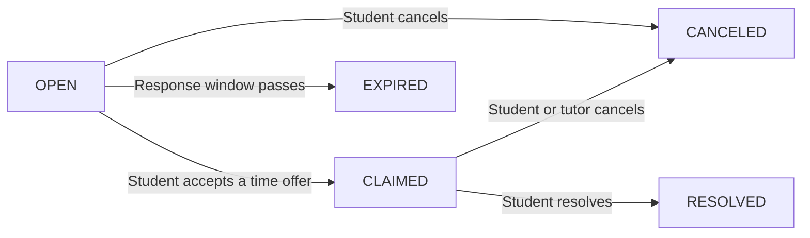

# RapidTutor implementation

Status as of October 16, 2026.

RapidTutor is a Spring Boot MVC application. A student posts a course-specific blocker and an optional token bounty. A tutor who covers that course offers a meeting time. The request stays open until the student accepts one offer. That acceptance claims the session. An open request can also expire when its response window passes, which refunds the bounty.

## Stack

| Layer | Technology | Main types |
| --- | --- | --- |
| Pages | Thymeleaf, Bootstrap 5, `app.css` | `templates/student/*`, `templates/tutor/*`, `templates/admin/*`, account pages |
| Security | Form login, BCrypt via a delegating encoder, role rules | `SecurityConfig`, `CustomAuthenticationSuccessHandler`, `MustChangePasswordInterceptor` |
| HTTP | Spring MVC | `AccountController`, `StudentController`, `TutorController`, `AdminController`, `NotificationController`, `KnowledgeAPIController` |
| Rules | Transactions and one request interceptor | `EconomyService`, `MeetingOfferService`, `AccountService`, `RequestExpiration`, `RequestExpirationInterceptor` |
| Notes | Optional Groq chat completion | `AiDiagnosisService`, `SocraticNotes`, `DiagnosticNoteChecker` |
| Data | H2 file at `./data/rapidtutor`, `ddl-auto=update` | Repositories under `com.rapidtutor.repository` |
| Seed | Demo users and course articles on startup | `DataSeeder` |

Passwords are stored with BCrypt. Demo accounts use `password`. A new account receives a recovery code, shown once, which can reset the password at `/forgot-password`. An administrator created from the overview page must change that temporary password before using the rest of the app.

`ddl-auto=update` adds columns. It does not drop columns left by an older local database. Delete the `data/` folder to start clean.

## Accounts

| Role | How it is created | After login |
| --- | --- | --- |
| `STUDENT` | `/register`, or seeded `student1` | `/student/dashboard` |
| `APPLICANT` | `/apply/tutor` | `/apply/status` until an admin decides |
| `TUTOR` | Admin approves an applicant, or seeded `tutor1` | `/tutor/board` |
| `DECLINED` | Admin declines an applicant | `/apply/status` |
| `ADMIN` | Seeded `admin`, or created from the overview | `/admin` |

Public registration creates students only. A student starts with 100 tokens. A tutor applicant starts with 0 and lists courses from `Courses.OFFERED`. Approval copies those courses onto `User.subjects` and sends a notification. Seeded `tutor1` already covers every offered course.

`/student/**` requires `STUDENT`, `/tutor/**` requires `TUTOR`, `/admin/**` and the H2 console require `ADMIN`. Other signed-in paths, including notifications and password change, allow any authenticated role.

## Request lifecycle

1. The student submits a course, topic, description, meeting method, response time, effort, and a bounty from 0 to 50. The server rejects anything outside that bounty range, a course that is not offered, and a fourth open request. The bounty is escrowed in the same transaction.
2. `AiDiagnosisService` asks Groq for three labeled lines: core concept, diagnostic question, and starting step. `DiagnosticNoteChecker` rejects a note that is missing a section, is too long, or contains a final answer. A rejected or failed call is replaced with the offline note from `SocraticNotes`. If `GROQ_API_KEY` is unset, the offline note is used immediately.
3. Tutors see open requests only when `SubjectMatcher` says their subjects cover the course. A tutor offers a future time. The request stays `OPEN`. The same tutor can replace their own offer or withdraw it. The student is notified.
4. The student accepts one offer. `MeetingOfferService.accept` sets `CLAIMED`, `assignedTutorId`, `claimedTimestamp`, and `offeredMeetingTime`, then deletes every offer on that request. The tutor is notified. The tutor's name on the page is `User.getPublicName()` for that id. It is not copied onto the request or the offer.
5. Either person can cancel a claimed session. The bounty is refunded. The other person is notified. The student can resolve a claimed session, which pays the bounty to the tutor, then leave one review scored from 1 to 5.
6. `RequestExpirationInterceptor` calls `RequestExpiration.expireDue()` on each request except `/css/**`. `ASAP` expires one hour after creation, `Within 2 hours` expires two hours after creation, and `Today` expires at the start of the next day. `Not urgent` does not expire. Expiration refunds the bounty, deletes offers, and records an `OPEN` to `EXPIRED` event. It does not set `canceledTimestamp`. That field is only for a cancel.

Student cancel, resolve, review, and details actions check that the signed-in student owns the request.

## Knowledge search

`GET /api/knowledge/search?topic=&course=` returns articles whose course is one of the offered courses and whose topic contains the text. The request form uses that search while the student types. There is no separate library page.

## Later work

- A concept-library page is not part of this build. Course-scoped search on the request form is the knowledge-bank behavior.
- A triage rule that keeps a request off the tutor board until the diagnostic note exists, and that checks a prior instructor comment against a new draft, is the next product change.
- A broader visual pass is separate from this behavior.
