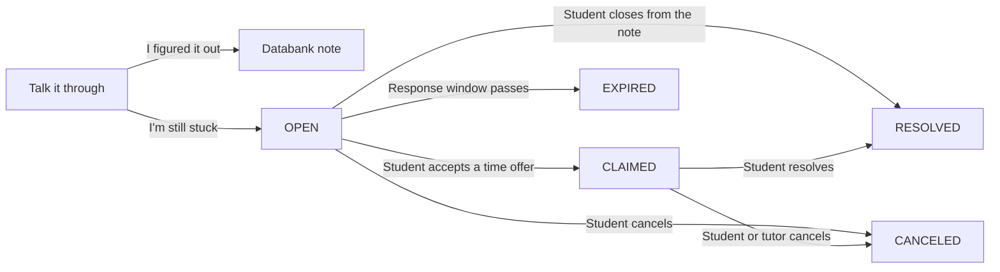

# LearnIT implementation

Status as of October 23, 2026.

LearnIT is a Spring Boot MVC application. A student tries to clear a course blocker before a person is involved. Soquacktic writes one diagnostic note and can reply once to what the student types. The shared databank keeps course notes and those diagnostic notes. If the student is still stuck, they can post for a peer tutor on this platform. Nothing in that flow stops them from getting help from a tutor somewhere else.

An administrator approves tutors and keeps accounts working. That management is how the platform runs. It is not the innovation.

## Stack

| Layer | Technology | Main types |
| --- | --- | --- |
| Pages | Thymeleaf, Bootstrap 5, `app.css` | `templates/student/*`, `templates/tutor/*`, `templates/admin/*`, account pages |
| Security | Form login, BCrypt via a delegating encoder, role rules | `SecurityConfig`, `CustomAuthenticationSuccessHandler`, `MustChangePasswordInterceptor` |
| HTTP | Spring MVC | `AccountController`, `StudentController`, `TutorController`, `AdminController`, `NotificationController`, `KnowledgeAPIController` |
| Rules | Transactions and one request interceptor | `EconomyService`, `MeetingOfferService`, `AccountService`, `RequestExpiration`, `RequestExpirationInterceptor` |
| Notes | Groq diagnostic note, with an offline fallback | `AiDiagnosisService`, `SocraticNotes`, `DiagnosticNoteChecker` |
| Data | H2 file at `./data/rapidtutor`, `ddl-auto=update` | Repositories under `com.rapidtutor.repository` |
| Seed | Demo users and course articles on startup | `DataSeeder` |

Passwords are stored with BCrypt. Demo accounts use `password`. A new account receives a recovery code, shown once, which can reset the password at `/forgot-password`. An administrator created from the overview page must change that temporary password before using the rest of the app.

`ddl-auto=update` adds columns. It does not drop columns left by an older local database. Delete the `data/` folder to start clean.

## Accounts

| Role | How it is created | After login |
| --- | --- | --- |
| `STUDENT` | `/register`, or seeded `student1` | `/student/dashboard` |
| `APPLICANT` | `/apply/tutor` | `/apply/status` until an admin decides |
| `TUTOR` | Admin approves an applicant, or seeded `tutor1` | `/tutor/board` |
| `DECLINED` | Admin declines an applicant | `/apply/status` |
| `ADMIN` | Seeded `admin`, or created from the overview | `/admin` |

Public registration creates students only. A student starts with 100 tokens. A tutor applicant starts with 0 and lists courses from `Courses.OFFERED`. Approval copies those courses onto `User.subjects` and sends a notification. Seeded `tutor1` already covers every offered course.

`/student/**` requires `STUDENT`, `/tutor/**` requires `TUTOR`, `/admin/**` and the H2 console require `ADMIN`. Other signed-in paths, including notifications and password change, allow any authenticated role.

## Request lifecycle

A request does not exist until the student is still stuck after the duck.

1. `POST /student/requests/duck` checks the course, topic, description, meeting method, response time, effort, and a bounty from 0 to 50. The server rejects anything outside that bounty range and a course that is not offered. It stores the draft and the first note in the session. A direct `POST /student/requests` without that draft does not create a request.
2. `AiDiagnosisService` asks Groq for three labeled lines: core concept, diagnostic question, and starting step. `DiagnosticNoteChecker` rejects a note that is missing a section, is too long, or contains a final answer. A rejected or failed call is replaced with the offline note from `SocraticNotes`. If `GROQ_API_KEY` is unset, the offline note is used immediately. The prompt does not receive a username, email, or student id.
3. `POST /student/requests/duck/reply` sends one follow-up that responds to the student's answer and replaces any earlier follow-up. **I'm still stuck** and **I figured it out** stay available before and after that reply.
4. **I figured it out** calls `KnowledgeBankService.saveTriage` with the course, topic, and the note. The follow-up is the note when one exists. Otherwise the first note is stored. The student's description and answer are not copied into the article. No request is posted.
5. **I'm still stuck** requires that answer and creates the request. The bounty is escrowed in the same transaction. The server also rejects a fourth open request. The stored note is the follow-up when one exists, otherwise the first note. The answer is saved on the request as `studentExplanation`.
6. An open request can be closed from the note. `TriageCloseService` refunds the bounty, sets `RESOLVED`, pays no tutor, deletes offers, notifies tutors who had offered a time, and saves the same note-only article.
7. Tutors see open requests only when `SubjectMatcher` says their subjects cover the course. A tutor offers a future time. The request stays `OPEN`. The same tutor can replace their own offer or withdraw it. The student is notified.
8. The student accepts one offer. `MeetingOfferService.accept` sets `CLAIMED`, `assignedTutorId`, `claimedTimestamp`, and `offeredMeetingTime`, then deletes every offer on that request. The tutor is notified. The tutor's name on the page is `User.getPublicName()` for that id. It is not copied onto the request or the offer.
9. Either person can cancel a claimed session. The bounty is refunded. The other person is notified. The student can resolve a claimed session, which pays the bounty to the tutor, then leave one review scored from 1 to 5. That review adds 10 tokens to the student's balance in the same transaction. A second review of the same request is rejected.
10. `RequestExpirationInterceptor` calls `RequestExpiration.expireDue()` on each request except `/css/**`. `ASAP` expires one hour after creation, `Within 2 hours` expires two hours after creation, and `Today` expires at the start of the next day. `Not urgent` does not expire. Expiration refunds the bounty, deletes offers, and records an `OPEN` to `EXPIRED` event. It does not set `canceledTimestamp`. That field is only for a cancel.

Student cancel, resolve, review, triage close, and details actions check that the signed-in student owns the request.

## Databank

`GET /student/knowledge` lists the shared notes. A triage article shows the course, the topic, the label Soquacktic, and the diagnostic note. It does not show the student's description or answer. Seeded course notes still show their question and solution.

`GET /api/knowledge/search?topic=&course=` returns articles whose course is one of the offered courses and whose topic contains the text. The request form uses that search while the student types. For a triage row, the form skips the stored question, including an older row that already contains a student's paragraph.

## Later work

- Comparing a new draft with a prior instructor comment is not part of this build.
- A broader visual pass is separate from this behavior.
