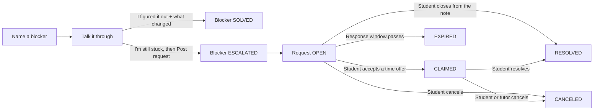

# LearnIT implementation

Status as of October 23, 2026.

LearnIT is a Spring Boot MVC application. A student tries to clear a course blocker before a person is involved. They name the blocker, Soquacktic writes one diagnostic note and can reply once to what the student types, and the student either writes what changed or asks for a peer tutor. Each attempt is kept on the student's **My blockers** page. The shared databank keeps course notes and those diagnostic notes. Nothing in that flow stops a student from getting help from a tutor somewhere else.

An administrator approves tutors and keeps accounts working. That management is how the platform runs. It is not the innovation.

## Stack

| Layer | Technology | Main types |
| --- | --- | --- |
| Pages | Thymeleaf, Bootstrap 5, `app.css` | `templates/student/*`, `templates/tutor/*`, `templates/admin/*`, account pages |
| Security | Form login, BCrypt via a delegating encoder, role rules | `SecurityConfig`, `CustomAuthenticationSuccessHandler`, `MustChangePasswordInterceptor` |
| HTTP | Spring MVC | `AccountController`, `StudentController`, `TutorController`, `AdminController`, `NotificationController`, `KnowledgeAPIController` |
| Rules | Transactions and a scheduled expiration sweep | `EconomyService`, `MeetingOfferService`, `AccountService`, `TriageCloseService`, `RequestExpiration` |
| Notes | Groq diagnostic note through `RestClient`, with an offline fallback | `AiDiagnosisService`, `SocraticNotes`, `DiagnosticNoteChecker` |
| Data | H2 file at `./data/rapidtutor`, `ddl-auto=update` | `DuckDraft`, `TutoringRequest`, `MeetingOffer`, `KnowledgeArticle`, and the repositories under `com.rapidtutor.repository` |
| Seed | Demo users and course articles on startup | `DataSeeder` |

Passwords are stored with BCrypt. Demo accounts use `password`. A new account receives a recovery code, shown once, which can reset the password at `/forgot-password`. An administrator created from the overview page must change that temporary password before using the rest of the app.

`ddl-auto=update` adds tables and columns. It does not drop old columns or widen existing ones. A database created before request descriptions allowed 2000 characters and review feedback allowed 1000 keeps the old 255-character columns. Delete the `data/` folder to start clean.

## Accounts

| Role | How it is created | After login |
| --- | --- | --- |
| `STUDENT` | `/register`, or seeded `student1` | `/student/dashboard` (My blockers) |
| `APPLICANT` | `/apply/tutor` | `/apply/status` until an admin decides |
| `TUTOR` | Admin approves an applicant, or seeded `tutor1` | `/tutor/board` |
| `DECLINED` | Admin declines an applicant | `/apply/status` |
| `ADMIN` | Seeded `admin`, or created from the overview | `/admin` |

Public registration creates students only. A student starts with 100 tokens. A tutor applicant starts with 0 and lists courses from `Courses.OFFERED`. Approval copies those courses onto `User.subjects` and sends a notification. The applicant's current session still carries the applicant role, so `/apply/status` tells an approved tutor to sign out and sign in again before opening the board. Seeded `tutor1` already covers every offered course.

A duplicate username or email that reaches the database's unique constraint, such as two sign-ups at once, is shown as the same form message as the normal duplicate check.

`/student/**` requires `STUDENT`, `/tutor/**` requires `TUTOR`, `/admin/**` and the H2 console require `ADMIN`. Other signed-in paths, including notifications and password change, allow any authenticated role.

## Student flow

The student home is **My blockers** at `/student/dashboard`. Its primary action is **Name a blocker**. A **Sessions** link opens `/student/requests`, the list of tutoring requests.

1. `POST /student/requests/duck` checks only the course, topic, and description through `RequestFields.blocker`. The course must be offered, the topic is at most 120 characters, and the description at most 2000. It saves a `DuckDraft` row for the student with the first note and outcome `TRYING`. The session holds only that draft's id.
2. `AiDiagnosisService` asks Groq for three labeled lines: core concept, diagnostic question, and starting step. The call has a 5-second connect timeout and a 20-second read timeout. `DiagnosticNoteChecker` rejects a note that is missing a section, has a section over 500 characters, or contains a final answer or a code block. A rejected or failed call is replaced with the offline note from `SocraticNotes`. If `GROQ_API_KEY` is unset, the offline note is used immediately. The prompt does not receive a username, email, or student id.
3. `POST /student/requests/duck/reply` sends one follow-up that responds to the student's answer and stores both on the draft. A second reply is rejected. **Start over** clears the draft from the session so a new first note can be written.
4. **I figured it out** requires a **What changed** entry of at most 500 characters. It calls `KnowledgeBankService.saveTriage` with the course, topic, and the note. The follow-up is the note when one exists. Otherwise the first note is stored. The student's description, answer, and takeaway are not copied into the article. The draft is marked `SOLVED` with the takeaway, and no request is posted.
5. **I'm still stuck** (`POST /student/requests/duck/book`) requires the answer and then shows the booking fields: meeting method, response time, session length, and a bounty from 0 to 50. **Post request** (`POST /student/requests`) checks those through `RequestFields.booking`, escrows the bounty, stores the note and answer on the request, and records the `OPEN` event in one transaction. The server rejects a fourth open request. The draft is marked `ESCALATED` and keeps the new request id. A direct `POST /student/requests` without a draft in the session does not create a request.

## Blockers

`DuckDraft` is the student's private record of a blocker: course, topic, description, note, follow-up, answer, takeaway, outcome, and an optional request id. Only its owner can load it. Nothing in it is shown to tutors or copied into the databank.

My blockers lists the student's drafts, newest first, labeled **Trying**, **Solved**, or **With a tutor**. A card with a takeaway shows **When I was stuck** next to **What changed**. An escalated card links to its request. When that request is `RESOLVED`, the card offers a **What changed** box that posts to `/student/drafts/{id}/takeaway`.

Current limits:

- A `TRYING` draft has no link back to Talk it through. Leaving the page or choosing Start over leaves it on the list as Trying.
- The **With a tutor** label comes from the draft outcome. It does not change when the linked request is canceled or expires.
- Requests posted before blockers were stored have no draft. They appear only on the Sessions page.

## Request lifecycle

1. An open request can be closed from the note. `TriageCloseService` refunds the bounty, sets `RESOLVED`, pays no tutor, deletes offers, notifies tutors who had offered a time, and saves the same note-only article.
2. Tutors see open requests only when `SubjectMatcher` says their subjects cover the course. A tutor offers a future time. The request stays `OPEN`. The same tutor can replace their own offer or withdraw it. The student is notified.
3. The student accepts one offer. `MeetingOfferService.accept` sets `CLAIMED`, `assignedTutorId`, `claimedTimestamp`, and `offeredMeetingTime`, then deletes every offer on that request. The tutor is notified. The tutor's name on the page is `User.getPublicName()` for that id. It is not copied onto the request or the offer.
4. The student can cancel an open request. The bounty is refunded, offers are deleted, and tutors who had offered a time are notified. Either person can cancel a claimed session. The bounty is refunded and the other person is notified. Each cancel runs in one transaction with its event.
5. The student can resolve a claimed session, which pays the bounty to the tutor, then leave one review scored from 1 to 5 with up to 1000 characters of feedback. That review adds 10 tokens to the student's balance in the same transaction. A second review of the same request is rejected.
6. `RequestExpiration.expireDue()` runs every 60 seconds. It loads open requests whose response time is `ASAP`, `Within 2 hours`, or `Today`. `ASAP` expires one hour after creation, `Within 2 hours` expires two hours after creation, and `Today` expires at the start of the next day. `Not urgent` does not expire. Each expired request is refunded, its offers are deleted, offering tutors are notified, and an `OPEN` to `EXPIRED` event is recorded, in its own transaction. It does not set `canceledTimestamp`. That field is only for a cancel. Offering or accepting a time after the deadline is rejected even when the sweep has not run yet.

Student cancel, resolve, review, triage close, takeaway, and details actions check that the signed-in student owns the request or draft.

An open request with no offers reloads its details page every 30 seconds to pick up new offers.

## Notifications

`/notifications` shows the 50 most recent notifications. Following an unread notification marks it read and then opens its link. Only links inside the app are followed. **Mark read** stays on the list.

## Databank

`GET /student/knowledge` lists the shared notes. A triage article shows the course, the topic, the label Soquacktic, and the diagnostic note. It does not show the student's description or answer. Seeded course notes still show their question and solution.

`GET /api/knowledge/search?topic=&course=` returns at most one article whose course is one of the offered courses and whose topic contains the text. Talk it through calls it 300 ms after the student stops typing the topic. For a triage row, the form skips the stored question, including an older row that already contains a student's paragraph.

## Admin

The overview lists accounts, tutor applications, and request counts by status. Insights show resolved counts, requests by course, the ten most common topics, score counts, the 20 most recent reviews, and average scores per tutor.

## Later work

- Comparing a new draft with a prior instructor comment is not part of this build.
- A broader visual pass is separate from this behavior.
